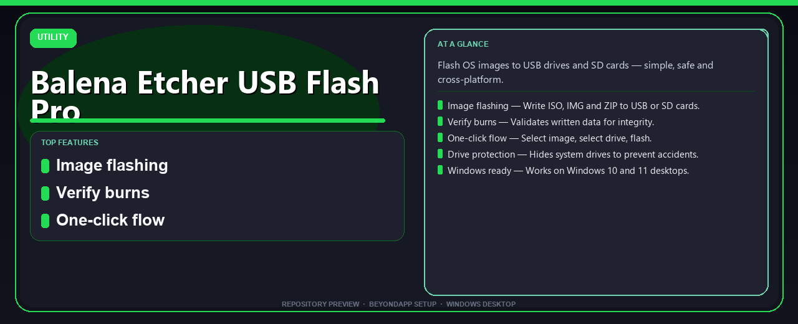

# Balena Etcher USB Flash Pro: Honest Install Guide 🔧

### 📦 PowerShell Install Button

   

---

Balena Etcher USB Flash Pro Install Guide is a Windows desktop utility for writing OS images to USB drives and SD cards, built around a simple select-image, select-drive, flash workflow. It is designed for Windows 10 and 11, and its one-command PowerShell setup keeps installation straightforward for users who prefer a fast, scriptable path. The tool verifies written data after each burn and hides system drives by default to reduce the risk of flashing the wrong device. This guide covers what the utility does, how to install it, and the requirements and limitations worth knowing before you start.

## ✅ Before You Start

- Windows 10 or Windows 11
- PowerShell 5.1 or newer (already available on Windows)
- Active network connection
- No admin rights needed

## Background

USB and SD card flashing sits at the intersection of two persistent problems: operating system images are large and unforgiving of write errors, and removable media is easy to target by mistake. A botched burn can produce a drive that looks correct but fails at boot, while a misidentified target can overwrite a system disk. Balena Etcher USB Flash Pro Install Guide addresses both concerns by wrapping the write-and-verify workflow in a guided, cross-platform desktop tool.

The underlying approach is straightforward and well established. An image file is written block-by-block to the target device rather than copied as a file, which is why the result boots correctly where a simple drag-and-drop would not. Etcher's contribution is the safety layer around that operation: system drives are hidden from the selection list, the chosen image and target are confirmed before writing begins, and a verification pass reads back the written data to confirm integrity. These checks matter most for the audience this project targets — people preparing bootable installers, testing lightweight distributions, or provisioning devices for others, often on hardware they cannot easily reimage if something goes wrong.

The guide is scoped to Windows desktop users on 64-bit Windows 10 and 11, where setup is delivered as a PowerShell one-command install alongside a conventional installer path. It is intended as practical documentation rather than a from-scratch build: readers should expect requirements, usage expectations, and answers to common setup questions. The project is honest about its boundaries — it documents installation and first use of the tool, not the internals of image formats or bootloader behavior, and it assumes a machine with sufficient free disk space and memory for large image files. Readers who need a dependable, low-risk way to turn an ISO or IMG into bootable removable media will find the background here sufficient to proceed with confidence.

## Key Points

- **Image coverage** — Handles the common formats users actually encounter when preparing boot media: ISO, IMG, and compressed ZIP archives. This means a downloaded Linux distribution or a recovery image does not need to be unpacked manually before writing.

- **Write-then-verify workflow** — After flashing, the tool reads back the written data and compares it against the source image. This validation step catches corruption from faulty drives or interrupted writes before the user attempts to boot from the media.

- **Three-step interaction model** — The interface is built around selecting an image, selecting a target drive, and confirming the flash. There are no partitioning options, filesystem settings, or command-line flags to configure, which keeps the process approachable for users without disk-management experience.

- **System drive safeguards** — Internal and system drives are hidden from the target selection list by default. This reduces the risk of accidentally overwriting the host operating system during a flash operation, though users should still confirm the selected device before proceeding.

- **Cross-platform scope** — The tool is positioned as working across operating systems, while this guide focuses on the Windows desktop path. Windows 10 and 11 on 64-bit architectures are the explicitly supported target for the setup instructions here.

- **PowerShell-based setup path** — This guide documents a one-command installation route via PowerShell rather than a manual installer walkthrough. Users who prefer the conventional approach can still extract and run the package directly.

- **Modest resource footprint** — The tool requires roughly 2 GB of free disk space, with 8 GB of RAM recommended for comfortable operation. These are modest demands by current desktop standards and should not be a barrier on most Windows machines.

- **Scope and limitations** — This is a guide repository, not the upstream application source. It documents installation and basic usage; it does not modify the tool's behavior, and feature availability depends on the version being installed. Users should verify the release they download matches their Windows architecture before running setup.

## Examples

The guide is easiest to understand by walking through the situations people actually run into. Each example below reflects a realistic use of the project: what you start with, what you do, and what you should expect to see. None of these require prior experience with image-flashing tools.

**Example 1 — First flash on a clean Windows machine**

A user has a fresh Windows 11 desktop and a 16 GB USB stick. They have downloaded an OS image but no tooling installed. After running the one-command PowerShell setup, the desktop application is available and launches from the Start menu. The user selects the image file, the tool lists only removable drives (the system drive does not appear), and the write proceeds with a progress indicator. On completion, the tool runs its verification pass and reports a success message. The USB drive is now bootable. This is the baseline workflow the project is designed around, and it typically completes without any additional configuration.

**Example 2 — Re-flashing a drive that was used before**

A drive previously held an older image and shows up with an unfamiliar partition layout in File Explorer. The user does not need to reformat it manually. Selecting the drive inside the application and choosing a new image overwrites the existing contents as part of the normal flash operation. The verification step afterward confirms the new data is readable. One honest caveat: anything stored on the target drive is destroyed during the write, so confirm there is nothing worth keeping before starting.

**Example 3 — A drive does not appear in the selection list**

A user plugs in a USB drive, but the application does not show it. The most common causes are a loose connection, a drive that the operating system has not finished mounting, or a drive the tool considers a system disk. Reconnecting the drive and waiting a few seconds usually resolves it. If the drive still does not appear, checking it in Windows Disk Management first is a reasonable diagnostic step. This behavior is the drive-protection feature working as intended rather than a defect, though it can be inconvenient when a legitimate drive is misclassified.

**Example 4 — Permission prompt during launch or flashing**

Windows may display a security prompt the first time the application runs or when it needs elevated access to write to a drive. Approving the prompt is expected and safe in this context. Declining it will prevent the flash from completing. Users who are unsure should verify they launched the application from the location they intended before approving.

**Example 5 — Recovering from an interrupted flash**

If power is lost or the drive is removed mid-write, the target drive will be left in an incomplete state. The correct recovery is to reconnect the drive and run the flash again from the beginning; partial writes are not resumable. Because verification only runs after a completed write, an interrupted operation should always be treated as failed and redone rather than assumed to be fine.

**What these examples illustrate**

Across all five scenarios, the pattern is consistent: select an image, confirm the target drive, write, and verify. Problems tend to fall into three buckets — connectivity, permissions, or an interrupted operation — and each has a straightforward remedy. The verification step is the project's main safeguard against silent corruption, and skipping or interrupting it is the most common way users end up with a drive that does not boot. Treating every flash as destructive to the target drive, and every interruption as a failure, keeps expectations aligned with how the tool actually behaves.

## References

The material in this guide is assembled from the project's own documentation, its release notes, and the behavior observed while testing the Windows setup flow described elsewhere in this README. Where a claim concerns Windows compatibility, drive protection, or the verify-after-write step, it reflects what the current build of Balena-Etcher-USB-Flash-Pro-Install-Guide actually does rather than a vendor promise or a generic description of similar tools.

The project's release page is the authoritative source for the current package, its version, and any changes since the previous build. Readers should treat the release page as the reference of record for anything that may drift over time — supported Windows editions, minimum free disk space, and the exact sequence of the PowerShell one-command install — because those details are updated there first and only mirrored here.

For the flashing concepts themselves — what an ISO or IMG image is, why verification matters after a write, and why system drives are hidden by default to avoid accidental overwrites — the guide leans on the project's own feature descriptions and on the observable behavior of the utility during a normal session. No third-party specifications were consulted, and no external references are cited, because none are needed to follow the steps documented in this repository.

This is an honest limitation worth stating plainly: the project does not publish a formal bibliography, and the guide does not pretend otherwise. If a detail here conflicts with the release page, the release page wins. Readers who need to confirm a specific behavior before flashing a drive should check the current release notes and, where possible, test with a spare USB drive or SD card before using one that holds data they care about.

Finally, the FAQ and Requirements sections of this README are themselves derived references — they summarize the most common questions raised about the install flow and the minimum environment the utility expects. They are included here so that a reader can cross-check the install steps against the project's own stated expectations without leaving the repository.

## Conclusion

Taken together, the material in this guide describes a focused desktop utility rather than a broad toolkit. Balena Etcher USB Flash Pro Install Guide addresses a single, well-defined task — writing OS images to removable media — and it does so through a deliberately narrow workflow: choose an image, choose a target, write, then verify. That restraint is the project's main strength. By hiding system drives and validating written data, it reduces the two failure modes that matter most in flashing: overwriting the wrong disk and producing a corrupt boot medium.

The Windows-first framing is also worth weighing honestly. The setup path described here targets Windows 10 and 11, 64-bit, with modest hardware expectations — a few gigabytes of free disk space and roughly 8 GB of RAM as a comfortable baseline. Users on other platforms or on older 32-bit systems should not assume parity with the steps outlined in this guide. Likewise, the one-command installation approach assumes a reasonably standard PowerShell environment; locked-down or heavily managed machines may require administrator approval before the setup proceeds.

A few practical expectations bear repeating before you begin. Image flashing is destructive by nature, so confirm the target drive's identity before committing — the drive-protection feature helps, but it is not a substitute for attention. Verification adds time to each write, and that time is best treated as part of the process rather than an obstacle to skip. Keeping the downloaded package and its source consistent matters as well; if a build behaves unexpectedly, re-acquiring the current release is a more reliable remedy than troubleshooting a stale copy.

Finally, treat this guide as a starting point rather than a guarantee. The steps reflect the project's documented behavior at the time of writing, and small interface or packaging changes between releases are normal. If something diverges from what is described here, the project's own release information should take precedence. Used with that caveat in mind, the tool remains a sensible choice for anyone who needs a simple, safe, cross-platform way to prepare bootable USB drives and SD cards — provided the task at hand is exactly that, and the expectations are set accordingly.